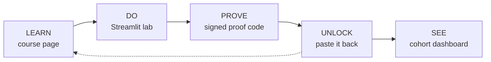
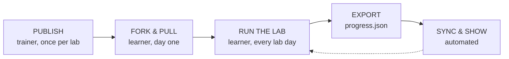

# LXM — Learning Experience Management

**Hands-on labs where every learner leaves proof of what they actually did.**

Built by [DevPro Academy](https://github.com/askanilkumar) with UNext.

---

## Why this exists

Twenty-five people attended the training. **Which of them can actually do the work on Monday?**

Most technical training cannot answer that. It is slides narrated for six hours, a lab that is really
a transcript with the answer printed in step 4, "any questions?" into a muted room, and a feedback
form on the last day that scores the trainer rather than the skill. Completion means somebody was
logged in.

That costs the business four ways:

| The cost | What it looks like |
|---|---|
| You bought hours, not capability | On Monday nobody can say which of the twenty-five can do the work |
| No transfer to your estate | Generic scenarios on sample data do not survive contact with your versions, your entitlements, your audit trail |
| Disengagement is invisible | In virtual delivery you cannot see a screen. A passive learner looks the same as an engaged one |
| You find out too late | The people who were lost surface in the feedback form, a week after the trainer has gone |

LXM answers each one. Not with a better slide deck — with a gate the learner cannot walk around.

---

## How it works



1. **Learn** — read the stage in the course page: the concept, a quiz, and the production scenarios an engineer meets on call.
2. **Do** — open the Streamlit app and do the work. A real pipeline you can break, tune and measure. No transcript to follow.
3. **Prove** — the app issues a **signed proof code** carrying what you actually did: your settings, your scores, whether you caught the planted problem.
4. **Unlock** — paste it into the course page. It is validated on the spot, and the next stage opens only on real work.
5. **See** — the cohort dashboard shows who is through, who is stuck, and at which stage — while the session is still running.

**The gate is the work, not a quiz.** The code is SHA-256 signed and bound to the learner's name, the
stage, and the time that stage unlocked. It cannot be replayed, edited, or borrowed from a colleague.

Tiers: **Bronze** (1 stage) → **Silver** (3) → **Gold** (5) → **Diamond** (Gold plus the stretch
challenge within 150 minutes). The stretch is deliberately out of reach of the normal path, so the
fast movers stay stretched instead of waiting for everyone else.

---

## What is in here

```
LXM_RAG_LAB/
├─ README.md               this file
├─ TRAINER_GUIDE.md        answer key and presenter notes — keep this out of learner hands
├─ docs/
│  ├─ LXM_Opening_Deck.pptx              7 slides, the 5-minute opening for a client call
│  └─ Proof-Based_Learning_Key_Benefits.pdf
├─ rag-lab/                AskIT Advanced RAG — 6 stages
│  ├─ app.py  rag_lab.html  rag/  data/kb/  sample_uploads/  dashboard/
│  └─ DEMO_SCRIPT.md       15-minute client demo runbook
└─ prompt-lab/             Orbi Prompt Lab — 6 stages
   ├─ app.py  prompt_lab.html  lab/  tests/  dashboard/
   └─ DEMO_SCRIPT.md       5-minute client demo runbook
```

Two labs, one model. The method is the product; the subject matter is a folder you control.

---

## Quick start

Pick a lab. Each one needs two things open side by side: **the course page in a browser** and
**the Streamlit app**.

### RAG lab

```bash
cd rag-lab
pip install -r requirements.txt
streamlit run app.py
```

Then open `rag-lab/rag_lab.html` in a browser.

### Prompt lab

```bash
cd prompt-lab
pip install -r requirements.txt
streamlit run app.py
```

Then open `prompt-lab/prompt_lab.html` in a browser.

**Both labs run fully offline.** Leave the API key box empty and everything still works — the RAG lab
falls back to hashed embeddings and extractive answers, the prompt lab to a small deterministic toy
model. Every stage completes, the numbers are just weaker. Nothing depends on your network.

With a key: the RAG lab takes **OpenAI**, the prompt lab takes **OpenAI or Azure AI Foundry**.

---

## Experiencing the labs

Do this once yourself before you put it in front of anyone.

### Step 1 — Start the course page

Enter your name and click **Start the lab**. Use the **same name** in the Streamlit sidebar — the
proof code is bound to it and will be rejected if the two differ.

### Step 2 — Work a stage

Each stage has four tabs: **Learn**, **Quiz**, **Production scenarios**, **Lab + proof**. Read the
stage, pass the quiz, then do what the lab step list tells you in Streamlit.

### Step 3 — Generate and paste the proof code

At the bottom of the matching Streamlit tab, click **Generate proof code**. Copy it, paste it into
the course page, click **Validate and score**. The stage completes when the **quiz is passed and the
proof validates** — both, not either.

Try pasting the same code twice. Then change one character and paste again. Both are rejected, for
different reasons. That is the whole accountability argument in twenty seconds.

### Step 4 — Finish the ladder

| Lab | Stages |
|---|---|
| **RAG** | 1 Architecture · 2 Ingestion · 3 Ask · 4 Evals · 5 How it works · 6 Stretch |
| **Prompt** | 1 Anatomy · 2 Mission 1 clarity · 3 Mission 2 structured output · 4 Mission 3 examples and injection · 5 Evals and cost · 6 Stretch |

### Step 5 — Export and see the cohort

Click **⇩ JSON** in the course page header to download `progress.json`, then open
`dashboard/index.html` to see what a cohort view looks like.

> **Trainers:** add `?trainer=1` to the course page URL — for example
> `rag_lab.html?trainer=1`. That gives you a button to insert a valid demo proof code for any stage,
> so you can jump ahead in a short demo. Answers are in [TRAINER_GUIDE.md](TRAINER_GUIDE.md).

---

## How a cohort runs



1. **Publish** — the course page, the Streamlit lab and the data live in one repository. One push reaches every learner.
2. **Fork and pull** — each learner forks and pulls into their VM or laptop. Same environment for everyone, ready in minutes.
3. **Run the lab** — they build, break and measure. Each stage ends in a signed proof code.
4. **Export** — the course page writes one small file: stages cleared, XP, tier, timings, and the codes behind them.
5. **Sync and show** — the file goes into their fork as `progress/<name>.json`. An action merges every
   progress file into one `data.json`, and GitHub Pages republishes the dashboard.

**The course page itself never goes to GitHub — only the results travel.** Each learner owns their own
evidence, keeps the history after the programme, and nobody can overwrite anyone else's record.

---

## What is real today, and what is designed

Worth being straight about if you are reviewing this repo or demoing it.

| | Status |
|---|---|
| The labs, the proof codes, the validation, the scoring | **Live.** Run them now, offline, no key needed. |
| The cohort dashboard | **Live page, sample data.** `dashboard/gen_data.py` regenerates it. |
| The GitHub sync (fork → action → merged `data.json`) | **Designed, not wired.** The screens in the course page are mocked. Walk through the flow; do not claim the action is firing in production. |
| Proof-code signing | **Tamper-evident, not tamper-proof.** The salt is in the page. It stops casual reuse, editing and sharing, which is what a classroom needs. For production, sign server-side. |

---

## Make it yours

The knowledge base in the RAG lab is 23 markdown files with version, audience, status and effective
date in the front matter. Replace them with your own procedures and the lab runs on your documents,
your failure modes, your compliance language — same code, same proof loop, same dashboard.

Same for the prompt lab: the scenario, the tickets and the hidden test set are in `lab/data.py`.

The labs are cloud-neutral. Nothing in the method is tied to one vendor.
